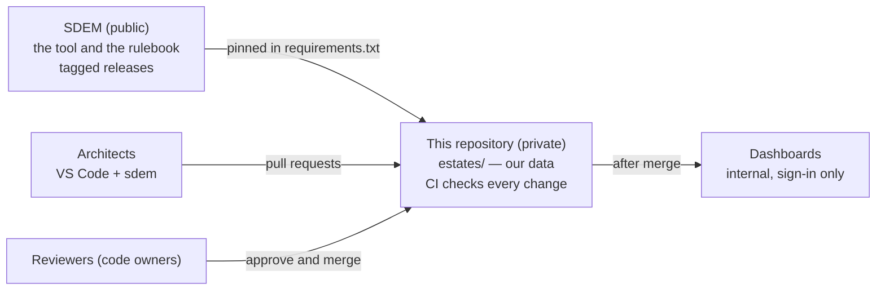

# Architecture estates — private

This repository holds **our real architecture data**, checked and built with a pinned release of [SDEM](https://github.com/taumoeps/bian-sdem-framework). It is **private**: SDEM itself is public and holds only made-up data; our data lives here and nowhere else.



## Set up (once — the platform owner)

1. **Create a private repository** in your organisation and copy this folder's contents into it (including the hidden `.github/`, `.gitignore` and `.vscode/`).
2. **Pin SDEM**: `requirements.txt` names the release tag. Keep it on a released tag, never `main`. If your network cannot reach GitHub, mirror the SDEM repository internally and point the line at the mirror.
3. **Name real reviewers** in `.github/CODEOWNERS` — people or teams, never a bot or an agent account.
4. **Protect `main`** (Settings → Branches, or Rules): require a pull request; require **1 approval** and **review from Code Owners**; dismiss stale approvals; require the **Estate checks / check** status; block force pushes and deletion; include administrators. Why each one matters: SDEM's [repository protection guide](https://github.com/taumoeps/bian-sdem-framework/blob/main/docs/sdem-repository-protection.md).
5. **Decide where dashboards are hosted** — authenticated internal hosting only (see *Dashboards* below). Until then, CI keeps them as a downloadable artifact.
6. **Copilot (optional)**: copy `.github/copilot-instructions.md`, `.github/agents/`, `.github/prompts/` and `.github/skills/` from the **same SDEM release** you pinned, so Copilot's guidance matches the commands. Only if your organisation allows Copilot; SDEM works without it.

## Every architect (once)

```bash
git clone <this repository> && cd <it>
python3 -m venv .venv && source .venv/bin/activate      # Python 3.10 or later (3.11+ recommended)
pip install -r requirements.txt
sdem --version                                           # the pinned version
bash ci/check-estates.sh                                 # the same checks CI runs
```

## Daily work — always on a branch, always through a pull request

```bash
git switch -c onboard/<design>
sdem transform run work/<design>-export -o work/history       # work/ is never committed
sdem load work/history --estate estates/<domain> --person <you>   # keep what is right; gaps are recorded
sdem check --estate estates/<domain>
sdem link --estate estates/<domain> -o work/links                 # proposed links
sdem approve P-RUN-001 --proposals work/links/proposals.json --estate estates/<domain> \
    --reviewer <you> --evidence application_architecture_document:<doc>#<section>   # a person approves, with evidence
git add estates/<domain> && git commit -m "Onboard <design> (LOAD-001)" && git push -u origin HEAD
```
Open a pull request; CI runs the **Estate checks**; a code owner reviews and merges. **Approvals become final when the pull request is merged.** The full walk-through: SDEM's [onboarding workflow](https://github.com/taumoeps/bian-sdem-framework/blob/main/docs/sdem-onboarding-workflow.md) and [user guide](https://github.com/taumoeps/bian-sdem-framework/blob/main/docs/sdem-workbench-user-guide.md).

## Adding a domain

Any domain works the same way: create `estates/<domain>/` (by onboarding its designs, or with its datasets and an empty `mappings.json`), add its reviewers to `.github/CODEOWNERS`, and name its estate owner. CI picks it up automatically.

**No per-domain settings are needed.** If your organisation's designs use table headings SDEM does not recognise (they show up as *column not mapped* or *no entity type* gaps), copy SDEM's `metamodel/transform-rules.json` to `rules/transform-rules.json`, add the headings under `tables`, and run `sdem transform run … --rules rules/transform-rules.json` — once, for every domain.

## What CI checks (`ci/check-estates.sh`)

| Check | Command | Fails when |
|---|---|---|
| Follows the rulebook | `sdem check --estate` | a record or link breaks a rule or control |
| Approved links unchanged | `sdem diff --git <base>` | an approved link was edited or removed (supersede it instead) |
| Builds | `sdem build --estate` | the knowledge graphs cannot be built |
| Open gaps | `sdem designs --gaps --status open` | never — listed for information |

After a merge to `main`, CI builds the home page and one dashboard per estate (`sdem home --root estates`) as the artifact **sdem-dashboards**.

## Dashboards

They show real architecture. Publish them **only** behind your organisation's sign-in — an internal web server or intranet, or GitHub Pages with **private** visibility if your plan offers it. Never public GitHub Pages, a public bucket, or a link without sign-in. Add your upload step at the end of `.github/workflows/estate-ci.yml`.

## Upgrading SDEM

1. On a branch, change the tag in `requirements.txt` to the new release; read its CHANGELOG.
2. `pip install -r requirements.txt`, then `bash ci/check-estates.sh`.
3. If SDEM says an estate's `metamodel_version` does not match, the rulebook changed: `sdem migrate --estate estates/<name> --person <you> --dry-run`, then without `--dry-run`. See SDEM's [rulebook versioning](https://github.com/taumoeps/bian-sdem-framework/blob/main/docs/sdem-rulebook-versioning.md).
4. If you use Copilot, copy the `.github/` Copilot files from the new release.
5. Pull request; CI green; merge.

## Rules

- **Real data stays here.** Never copy it to the public SDEM repository, an issue, or a chat outside your organisation. Design exports stay in `work/`, on the machine allowed to hold them.
- **Change data with SDEM commands**, not by hand: they check first and record who did what.
- **A reviewer is a person.** Agents and bots propose; people approve.
- Problems with SDEM itself: an issue on the SDEM repository **without any real data**; security problems: SDEM's `SECURITY.md`.
