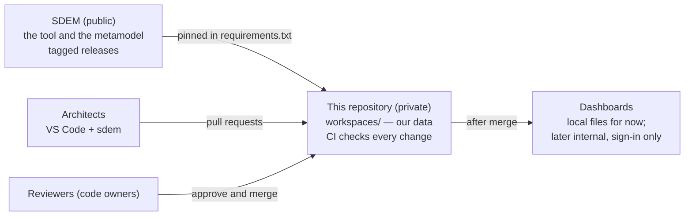

# Architecture workspaces — private

This repository holds **our real architecture data**, checked and built with a pinned release of [SDEM](https://github.com/taumoeps/bian-sdem-framework). It is **private**: SDEM itself is public and holds only made-up data; our data lives here and nowhere else.



## Set up (once — the platform owner)

1. **Create a private repository** in your organisation and copy this folder's contents into it (including the hidden `.github/`, `.gitignore` and `.vscode/`).
2. **Pin SDEM**: `requirements.txt` names the release tag. Keep it on a released tag, never `main`. If your network cannot reach GitHub, mirror the SDEM repository internally and point the line at the mirror.
3. **Name real reviewers** in `.github/CODEOWNERS` — people or teams, never a bot or an agent account.
4. **Protect `main`** — after the checks have run once (open a first pull request): require a pull request; **1 approval** and **review from Code Owners**; dismiss stale approvals; require the status check **`check`** (shown as *Workspace checks / check* — not `validate`, which is SDEM's own); block force pushes and deletion; include administrators. Step by step, and how to test it: SDEM's [repository protection guide](https://github.com/taumoeps/bian-sdem-framework/blob/main/docs/sdem-repository-protection.md) §1–§4.
5. **Dashboards** — local HTML files for now; later, authenticated internal hosting only (see *Dashboards* below).
6. **Copilot (optional)** — only if your organisation allows it; SDEM works without it. After step 2, in this repository: `sdem copilot install` — it writes SDEM's Copilot instructions, agents, prompts and skills into `.github/`, matching the SDEM version you pinned. Commit them.
7. **Your BIAN layer** — once, by your in-house SDEM lead, shared by every domain:
   ```bash
   sdem bian import --base --all -o bian/a2-service-domain.json     # or --only "<service domain>" … — see bian/README.md
   ```
   Confirm the report, commit `bian/`. Choosing service domains, your own BIAN instead of the base, and keeping every workspace up to date (`sdem bian update`): [`bian/README.md`](bian/README.md).
8. **Policies to confirm** before real designs come in: legal and IP clearance, Copilot (allowed or not), and reading text in pictures (OCR — allowed or `--ocr off`). The checklist: SDEM's [adoption checklist](https://github.com/taumoeps/bian-sdem-framework/blob/main/docs/sdem-adoption-checklist.md).

## Every architect (once)

```bash
git clone <this repository> && cd <it>
python3.13 -m venv .venv && source .venv/bin/activate   # Python 3.10 or later (3.13 recommended); not found? /opt/homebrew/bin/python3.13
pip install -r requirements.txt
sdem --version                                           # the pinned version
bash ci/check-workspaces.sh                                 # the same checks CI runs (approved links compared with main)
```

## Daily work — always on a branch, always through a pull request

```bash
git switch -c onboard/<design>
sdem new --workspace workspaces/<domain> --person <you>         # once per area — starts it with the shared BIAN layer (bian/a2-service-domain.json)
sdem transform run work/imports/<design> -o work/history       # keep the export in work/ — never committed; add --ocr off if your policy says so
sdem load work/history --workspace workspaces/<domain> --person <you> --exclude <ids you reject>   # gaps are recorded
sdem check --workspace workspaces/<domain>
sdem link --workspace workspaces/<domain> --out work/links              # proposed links
sdem approve P-RUN-001 --proposals work/links/proposals.json --workspace workspaces/<domain> \
    --reviewer <you> --evidence application_architecture_document:<doc>#<section>   # a person approves, with evidence
sdem connect <BIAN service domain> REALIZED_BY <application> --workspace workspaces/<domain> \
    --reviewer <you> --evidence application_architecture_document:<doc> --rationale "<why>"     # a connection SDEM cannot see from the design
git add workspaces/<domain> && git commit -m "Onboard <design> (LOAD-001)" && git push -u origin HEAD
```
Open a pull request; CI runs the **Workspace checks**; a code owner reviews and merges. **Approvals become final when the pull request is merged.** Your BIAN layer is `bian/a2-service-domain.json` (set-up step 7; [what it is](https://github.com/taumoeps/bian-sdem-framework/blob/main/docs/sdem-onboarding-workflow.md#your-bian-a2-layer)). To practise first, the made-up sample export is in a clone of SDEM: `examples/designs/confluence-folder-export`. The full walk-through: SDEM's [onboarding workflow](https://github.com/taumoeps/bian-sdem-framework/blob/main/docs/sdem-onboarding-workflow.md) and [user guide](https://github.com/taumoeps/bian-sdem-framework/blob/main/docs/sdem-workbench-user-guide.md).

## Adding a domain

Any domain works the same way: create `workspaces/<domain>/` (by onboarding its designs, or with its datasets and an empty `mappings.json`), add its reviewers to `.github/CODEOWNERS`, and name its workspace owner. CI picks it up automatically.

**No per-domain settings are needed.** If your organisation's designs use table headings SDEM does not recognise (they show up as *column not mapped* or *no entity type* gaps), write a copy of SDEM's rules once — `sdem transform rules -o rules/transform-rules.json` — add the headings under `tables`, commit it, and pass `--rules rules/transform-rules.json` to `sdem transform` — for every domain.

## What CI checks (`ci/check-workspaces.sh`)

| Check | Command | Fails when |
|---|---|---|
| Follows the metamodel | `sdem check --workspace` | a record or link breaks a rule or control |
| Approved links unchanged | `sdem diff --git <base>` | an approved link was edited or removed (supersede it instead) |
| Builds | `sdem build --workspace` | the knowledge graphs cannot be built |
| Open gaps | `sdem designs --gaps --status open` | never — listed for information |

After a merge to `main`, CI builds the home page and one dashboard per workspace (`sdem home --root workspaces`) as the artifact **sdem-dashboards**.

## Dashboards

They show real architecture. Publish them **only** behind your organisation's sign-in — an internal web server or intranet, or GitHub Pages with **private** visibility if your plan offers it. Never public GitHub Pages, a public bucket, or a link without sign-in. Add your upload step at the end of `.github/workflows/workspace-ci.yml`.

**To start: local files.** Each architect builds them on their own machine — `sdem home --root workspaces -o work/sdem`, then open `work/sdem/index.html` in a browser. `work/` is never committed. CI's *sdem-dashboards* artifact is the same pages, for anyone without SDEM installed.

## Upgrading SDEM

1. On a branch, change the tag in `requirements.txt` to the new release; read its CHANGELOG.
2. `pip install -r requirements.txt`, then `bash ci/check-workspaces.sh`.
3. If SDEM says a workspace's `metamodel_version` does not match, the metamodel changed: `sdem migrate --workspace workspaces/<name> --person <you> --dry-run`, then without `--dry-run`. See SDEM's [metamodel versioning](https://github.com/taumoeps/bian-sdem-framework/blob/main/docs/design/sdem-metamodel-versioning.md).
4. If you use Copilot: `sdem copilot install` — it updates the Copilot files to the new SDEM version and keeps any your team has changed (it lists them).
5. Pull request; CI green; merge.

## Rules

- **Real data stays here.** Never copy it to the public SDEM repository, an issue, or a chat outside your organisation. Design exports stay in `work/`, on the machine allowed to hold them.
- **Approved connections and loads change only through SDEM commands** (`sdem approve`, `sdem load`, `sdem designs resolve|accept`): they check first and record who did what. Never edit `mappings.json`, `loads/` or `designs/` by hand — CI refuses an edited approved connection.
- **Editing a layer's records by hand is fine** (e.g. adding an application to `a3-application.json`): then run `sdem check --workspace workspaces/<domain>` and open a pull request. Once agents work on a layer through change sets, SDEM asks you to record a hand edit with `sdem change adopt` (it tells you when).
- **A reviewer is a person.** Agents and bots propose; people approve.
- Problems with SDEM itself: an issue on the SDEM repository **without any real data**; security problems: SDEM's `SECURITY.md`.
